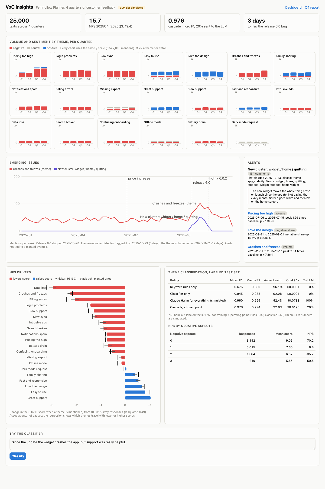
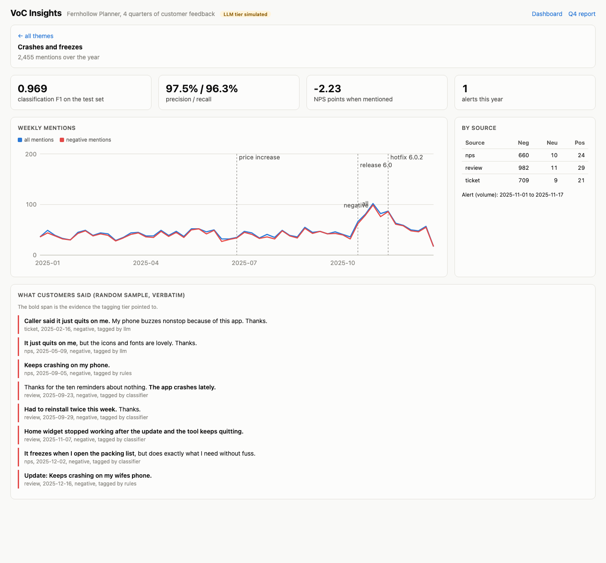

# VoC Insights

Voice of customer analytics for Fernhollow Planner, a made-up family calendar app. It turns 25,000 survey comments, app store reviews, and support ticket summaries from four quarters into themes, sentiment per theme, emerging issues, NPS drivers, and a quarterly insights report a product leader would read. Themes are tagged by a cascade: keyword rules, then a TF-IDF classifier, then Claude Haiku for the 20% of texts the cheaper tiers are unsure about. A release bug planted in quarter 4 is flagged 3 days after it ships. **The Claude numbers are simulated** (see [Simulated LLM tier](#simulated-llm-tier)); no real API run was done, and all data is synthetic.



**Theme classification**, 750 held-out labeled texts (20 themes, multi-label):

| Policy | Micro F1 | Macro F1 | Exact match | Aspect sentiment acc | Cost per 1k texts | Sent to an LLM |
|---|---|---|---|---|---|---|
| Keyword rules only | 0.675 | 0.680 | 41.3% | 96.1% | $0.0001 | 0% |
| Classifier only (TF-IDF + logistic regression) | 0.945 | 0.933 | 87.5% | 92.0% | $0.0001 | 0% |
| Claude Haiku for everything (simulated) | 0.960 | 0.959 | 88.9% | 92.4% | $0.0783 | 100% |
| **Cascade, chosen point** (LLM tier simulated) | **0.976** | **0.974** | **93.6%** | 92.6% | **$0.0190** | 20% |

Reproduce with `make eval`. Aspect sentiment accuracy is measured on the (text, theme) pairs each policy found, so the rules row scores high on the easy cases it does catch.

## Why

Product teams sit on thousands of comments a quarter and read maybe a hundred. The usual results are a word cloud nobody trusts or a vendor dashboard that cannot say why NPS moved. The useful version has to do four things well: tag each comment with the themes in it and the customer's feeling about each one (a comment can love the design and hate the price), notice a new problem within days instead of at the quarterly review, say which themes actually move the score, and write it up without inventing numbers or quotes. This repo builds each piece, measures it against planted ground truth, and keeps LLM spend to the texts where it changes the answer.

## Architecture

```
NPS comments ─┐
app reviews ──┼─▶ 0 keyword rules: every clause matched ── conf ≥ 0.90 ──▶ themes
tickets ──────┘     │ otherwise
                    ▼
                  1 TF-IDF (words + char n-grams) + one-vs-rest logistic regression
                    │   conf = least certain theme's distance from 0.5 ── ≥ 0.40 ──▶ themes
                    ▼
                  2 Claude Haiku 5.5, JSON schema: themes, sentiment per theme, quoted evidence
                    │   validator: enums, no duplicates, evidence must be verbatim in the text
                    ▼   bad output ▶ fall back to tier 1; theme "other" ▶ kept as a new-issue lead
aspect sentiment per theme (clause lexicon with negation and sarcasm frames, prior from labels)
                    │
       ┌────────────┼────────────────┬───────────────────┬────────────────────┐
       ▼            ▼                ▼                   ▼                    ▼
 themes by     emerging issues:   new-cluster       NPS drivers:          quarterly report:
 quarter and   Poisson volume +   detection:        OLS of score on       facts ▶ writer (template
 sentiment     negative-share     bursting terms    theme presence,       or Claude) ▶ validator
               tests vs 8 weeks   grouped by        HC1 errors, caveats   rejects unknown numbers
                                  co-occurrence                           and quotes ▶ MD + HTML
```

| Piece | File |
|---|---|
| Hidden taxonomy: 20 themes with phrase banks, implicit phrasings, sarcasm, planted NPS effects, the Q4 bug | `src/vocinsights/taxonomy.py` |
| Seeded generator: 25,000 texts over 2025, 3 sources, multi-theme, typos, synonyms, label noise, planted events | `src/vocinsights/data.py` |
| Rules tier with clause coverage confidence | `src/vocinsights/rules.py` |
| Multi-label classifier | `src/vocinsights/classifier.py` |
| Claude tagger, schema validator, simulated tagger, prices | `src/vocinsights/llm.py`, `pricing.py` |
| Cascade and policy evaluation (micro and macro F1, per-theme P/R, cost) | `src/vocinsights/cascade.py`, `evaluate.py` |
| Aspect sentiment | `src/vocinsights/sentiment.py` |
| Unsupervised theme discovery with purity and NMI | `src/vocinsights/discovery.py` |
| Emerging issues and new-cluster detection | `src/vocinsights/emerging.py` |
| NPS drivers and NPS vs sentiment | `src/vocinsights/drivers.py` |
| Report facts, writers, validator, Markdown and HTML | `src/vocinsights/report.py` |
| API, metrics, JSON logs, web UI | `src/vocinsights/app.py`, `metrics.py`, `logs.py`, `static/` |

## Results

**Data.** 25,000 texts across 2025: 40% NPS comments with a 0 to 10 score, 35% app reviews with 1 to 5 stars, 25% ticket summaries. 43% mention two or more themes, 5% mention none ("Love it!"), 7% contain sarcasm, 30% of mentions use an implicit phrasing with no obvious keyword ("my phone is dead by lunch"). 2,500 texts form the labeled subset (1,750 train, 750 test); the annotators drop or add a theme on about 9% of them, and the classifier trains on those noisy labels. Evaluation is against the true themes.

**Cascade.** The sweep tries rules on or off and 7 classifier thresholds. The rule: take the cheapest point within 0.5 F1 points of the best. That picks `rules 0.90, classifier 0.40`. Across the full corpus, 25% of texts stop at the rules, 56% at the classifier, and 19% go to Haiku. The weakest themes are Offline mode (recall 0.88) and Intrusive ads (0.89), both because their implicit phrasings ("useless on the subway", "so many sponsored popups") share few words with the explicit ones.

**Sentiment.** 92.6% of per-theme sentiments are right on themes the cascade found, 92% on sarcastic comments. Neutral is the weak class (F1 0.69): "please add an export" and "there is no export" read alike to a lexicon. NPS falls with each negative aspect: mean score 9.06 with none, 7.66 with one, 6.57 with two, 5.66 with three or more (NPS +70, +9, -36, -60). Correlation between score and net aspect sentiment: 0.57.

**Emerging issues.** Two events are planted: a price increase on 2025-07-01 and release 6.0 on 2025-10-20, whose home screen widget crashes the app until hotfix 6.0.2 on 2025-11-17.

| Detector | What it flagged | When |
|---|---|---|
| Theme volume test, Pricing too high | 1.99 times baseline | 2025-07-06, 5 days after the price change |
| New-cluster detection: "widget / home / quitting" | 164 comments, all of them about the bug (64% of the 255 bug comments) | 2025-10-23, 3 days after release |
| Theme volume test, Crashes and freezes | 2.04 times baseline | 2025-11-01, 12 days after release |
| False alarm: Love the design, negative share | one day, lift 14.5 points | 2025-09-21 |

The new-cluster detector is faster because the bug's words ("widget", "home widget", "stopped working") are new, while the crash theme already had about 50 mentions a week, so the bug needs time to stand out from that baseline.

**NPS drivers.** Regression of the 0 to 10 score on predicted theme presence over 10,031 survey responses (R squared 0.49). It recovers the generator's planted effects within 0.3 points for the large ones: Data loss -2.99 (planted -3.20), Crashes -2.29 (-2.15), Billing errors -2.10 (-2.40), Great support +1.25 (+1.35), Easy to use +1.00 (+1.01). The report states the caveats: associations, not causes; only people who commented; tagging errors shrink effects.

**Theme discovery.** Unsupervised clustering does poorly at recovering the taxonomy, and that is worth knowing. NMF with 20 topics: purity 0.30, NMI 0.23, 2 of 20 themes recovered as a majority cluster. K-means with 20: purity 0.24. NMF with 40: purity 0.43, 9 themes. Clusters form around phrasings ("price / justify price") rather than themes, and multi-theme comments blur them. Use it to propose candidate themes for a person to curate, not as the taxonomy.

**Report.** `make report` writes [reports/insights-2025Q4.md](reports/insights-2025Q4.md) and an HTML version: headline numbers, top themes with quarter-on-quarter change, movers, emerging issues, verbatim quotes sampled with a fixed seed, NPS drivers with confidence intervals, and caveats. The summary bullets come from a template by default or from Claude with `VOC_WRITER=claude`. Either way a validator checks every number against the computed facts and every quoted span against the feedback, and a rejected Claude summary falls back to the template with a note in the report.

### Choices made with the results in view

- The detector thresholds (p below 1e-4, ratio at least 1.5, 10 or more mentions, term bursts at 4 times baseline) were tuned on this same synthetic year while looking at the alerts. With them there is one false alarm; looser settings give more.
- The NPS baseline in the generator was raised so overall NPS lands near +15 to +20, which is plausible for a consumer app. It does not change the driver coefficients.
- The synthetic text comes from phrase banks, so even with typos, synonyms, and implicit phrasings it is more regular than real feedback. Expect lower F1 on real comments, and more of them routed to the LLM.

## Simulated LLM tier

There is no API key in this project, so the Haiku tier runs as `SimulatedTagger`. On labeled texts it finds each true theme with probability 0.95, adds a wrong theme 4% of the time, gets sentiment right 94% of the time (88% on sarcasm), quotes the clause that best matches as evidence, and reports token counts from the real system prompt length. Those settings are assumptions. Every simulated row is labeled in the table, the API, and the UI. `ClaudeTagger` is the real client: it calls `claude-haiku-5-5` with the JSON schema in `output_config.format`, and its tests run against a fake client. Set `VOC_LLM=claude` with `ANTHROPIC_API_KEY` to route live API requests through it; the batch evaluation stays simulated so it is free and repeatable.

## Run it

```bash
cd voc-insights
uv sync --python 3.12
make run           # http://127.0.0.1:8873, ready in about 15 seconds
```

Other targets: `make test`, `make lint`, `make eval`, `make gate`, `make report`, `make screenshot` (server running). `VOC_TEXTS=6000 make run` starts faster.

```bash
curl -s localhost:8873/api/classify -H 'content-type: application/json' \
  -d '{"text":"Since the update the widget crashes the app, but support was really helpful."}'
curl -s localhost:8873/api/feedback -H 'content-type: application/json' \
  -d '{"items":[{"text":"way too many ads","source":"review","score":2}]}'
curl -s localhost:8873/api/emerging
curl -s 'localhost:8873/api/report?quarter=2025Q4&format=html' > report.html
```

| Endpoint | What it does |
|---|---|
| `POST /api/classify` | Tag one text: themes, sentiment per theme, evidence span, tier, confidence, cost. |
| `POST /api/feedback` / `GET /api/feedback` | Ingest up to 500 texts per call (source, date, score), classify them, list what was ingested. |
| `GET /api/themes`, `GET /api/themes/{theme}` | Volume and sentiment per theme per quarter; weekly series, sources, sampled quotes, driver, and test F1 for one theme. |
| `GET /api/emerging` | Alerts, new clusters, detection timing for the planted events, weekly series. |
| `GET /api/drivers` | Driver coefficients with 95% intervals, prevalence, impact, planted values, NPS vs aspect sentiment. |
| `GET /api/discovery` | Clusters, names, purity, and NMI for NMF and k-means. |
| `GET /api/eval` | Policy table, per-theme precision and recall, sweep, operating point. |
| `GET /api/report?quarter=&format=md\|html\|json` | The quarterly report. |
| `GET /healthz`, `GET /metrics` | Health and Prometheus metrics (texts classified by tier, LLM spend, reports and validator rejections, requests, startup time, eval F1). |

The web UI at `/` has the theme small multiples (stacked sentiment bars per quarter, one shared y scale), a detail page per theme with weekly lines and quotes, the emerging issues chart and alert list, the driver chart, the evaluation table, and a box to classify your own text. Light and dark mode follow the system setting; it works at phone width.



Logs are one JSON object per line on stdout: startup timings, every request, every classification and ingest, every report with its writer and validator result.

## Tests

116 tests, about 30 seconds: `uv run pytest -q`.

| File | Tests | What they check |
|---|---|---|
| `test_data.py` | 10 | Determinism, source mix, score ranges, multi-theme, sarcasm and no-theme shares, the Q4 bug only after release, ramp and fade, price change lift, label noise, split |
| `test_rules.py` | 6 | Clause splitting, confident single and multi-theme matches, unexplained or ambiguous clauses lower confidence |
| `test_classifier.py` | 5 | Label matrix, threshold and confidence math, multi-label output, typo robustness, valid probabilities |
| `test_llm.py` | 21 | Schema validation (enums, missing and extra fields, duplicates, invented evidence), request shape with a fake client, bad JSON, refusal, cost, simulated tagger determinism, "other" for the new issue |
| `test_cascade.py` | 11 | Routing per tier, threshold controls LLM share, LLM off, cost, bad output falls back, "other" kept as a new-issue lead, evidence spans come from the text |
| `test_evaluate.py` | 6 | F1 math on hand-computed examples, macro skips absent themes, policy ordering, simulated rows marked, gate |
| `test_sentiment.py` | 14 | Lexicon on hand-built clauses (negation, sarcasm, requests), aspect split across "but", priors, metric math, accuracy floor |
| `test_discovery.py` | 7 | Purity and NMI on known values, NMI matches scikit-learn, discovery output |
| `test_emerging.py` | 10 | Window sums, episodes, no alert on a flat series, a planted spike caught within 4 days, stricter settings are slower, the Q4 bug flagged with its cluster, few false alarms |
| `test_drivers.py` | 5 | OLS recovers a planted effect, NPS formula, planted effect math, generator effects recovered, NPS falls with negative aspects |
| `test_report.py` | 12 | Facts, quotes are verbatim, template passes, validator rejects invented numbers, quotes, and dates, Claude writer used when valid and replaced when not, HTML escaping |
| `test_api.py` | 9 | Every endpoint end to end, validation errors, ingest, report formats, and the service with a fake Claude tagger |

## DevOps

- `.github/workflows/ci.yml`: ruff check and format, pytest, a **quality gate** job that runs the full 25,000 text evaluation and fails if cascade micro F1 drops below 0.93 or the planted Q4 bug is not flagged (results go to the job summary and an artifact), and a Docker build with a container smoke test on 4,000 texts.
- `Dockerfile`: multi-stage uv build, slim runtime, non-root user, HEALTHCHECK on `/healthz` with a 90 second start period for the startup build. The service keeps its state in memory and writes nothing to disk.
- Docker is not installed on the machine this was built on, so the image is built and smoke tested only in CI. Everything runs without Docker through `uv run`.

## Production notes

- Replace the startup build with a pipeline: ingest into a warehouse table, tag in nightly batches through the Message Batches API at half price, and serve the analytics from precomputed tables.
- Label a few thousand real comments with two annotators each, measure their agreement, and run the real Haiku tier on them before trusting the cascade thresholds. The simulated settings decide how much goes to the LLM.
- Version the taxonomy. When the new-cluster detector finds an issue that sticks, add the theme, label examples, retrain, and backfill so trend lines stay comparable.
- Route alerts to the owning team with the top terms and five example comments, and track time to acknowledge. Tune thresholds on a held-out year, not the year being monitored.
- Treat comments as personal data: redact emails, names, and order numbers before they reach any model or report, and keep the raw text behind access controls.
- Weight survey drivers for response bias, and check them against a holdout where a fix shipped. Regression on comments shows associations, not what a fix will do to NPS.

## License

MIT. See [LICENSE](LICENSE).
